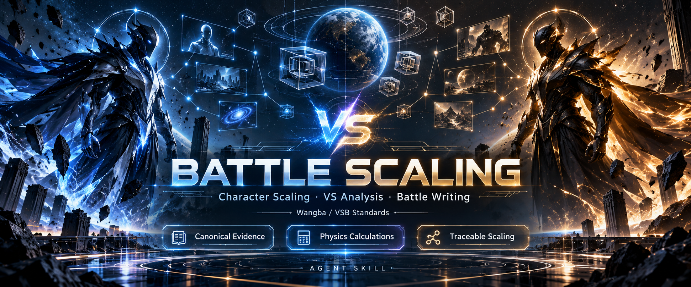

[简体中文](README.md) | **English**



<div align="center">

# Battle Scaling

### Research the canon. Settle the matchup. Make it watchable.

Character ratings · VS analysis · battle stories · posters · beat-synced videos

   

**[Download the full toolkit](https://github.com/LEE-path/battle-scaling/releases/download/v1.21.0/battle-scaling-v1.21.0.zip)** · [ Installation guide ](docs/INSTALL.md) · [ Watch demos ](#see-it-in-action) · [Release](https://github.com/LEE-path/battle-scaling/releases/tag/v1.21.0)

</div>

From a version-specific character question to a sourced rating, a battle with a clear outcome and shareable visual outputs. Wangba is the default; full VSB mode is available. Use the same independent character research across ratings, matchup analysis and stories, then invoke media tools when needed.

## See it in action

Click a preview to open the full video with audio.

<table>
<tr><th>Thanos vs The Flash</th><th>Murphy Law vs Thanos</th></tr>
<tr>
<td align="center"><a href="https://github.com/user-attachments/assets/aeb27429-cbfc-402f-851f-b4ba20bc6ce3"></a></td>
<td align="center"><a href="https://github.com/user-attachments/assets/9ed4cdcf-7b0e-46dd-b62a-0cf67b1d39c3"></a></td>
</tr>
<tr><td align="center">Cinematic footage · beat cuts · attribute reveals</td><td align="center">Rare-character animation · dynamic art · varied highlights</td></tr>
</table>

**Editing & media demonstrations** · The sample scores illustrate presentation, not current canonical ratings. [ Sources and sample notes ](docs/SHOWCASE.md)

<details>
<summary><b>Full videos with audio — expand players</b></summary>

**Thanos vs The Flash / 六宝石灭霸 vs 闪电侠**

https://github.com/user-attachments/assets/aeb27429-cbfc-402f-851f-b4ba20bc6ce3

**Murphy Law vs Thanos / 吕墨菲 vs 六宝石灭霸**

https://github.com/user-attachments/assets/9ed4cdcf-7b0e-46dd-b62a-0cf67b1d39c3

</details>

### A matchup can become a cover, too

<table>
<tr><th>Live-action poster</th><th>Anime poster</th></tr>
<tr>
<td></td>
<td></td>
</tr>
</table>

<details>
<summary><b>Also supports one-image victory memes — expand example</b></summary>

<p align="center"></p>

Existing results become a collage: winner left, loser right, an overlay and localized text. The image does not create a new rating.

</details>


## Choose what to make

<table>
<tr><td width="50%"><b>📚 Canon research & novel dossiers</b><br>Trace abilities to their actual feats. Follow states, versions, chapters and source context.</td><td width="50%"><b>📐 Physics & higher structures</b><br>Materials, geometry, forces and energy; mathematical hierarchies and narrative relations.</td></tr>
<tr><td width="50%"><b>⚖️ One integrated rating</b><br>Wangba or VSB, nine attributes, explicit scaling and a traceable overall tier.</td><td width="50%"><b>⚔️ Matchups & battle writing</b><br>Win paths, counters and tactical feedback, with characterization and readable causality.</td></tr>
<tr><td width="50%"><b>🎬 Posters & editable video</b><br>Transparent cover assets, collage, nine beat-timing presets and MP4 export.</td><td width="50%"><b>🔌 Find media, connect tools</b><br>Search/extract/download; connect image/video APIs, MCPs, CLIs or selected local models.</td></tr>
</table>

<details>
<summary><b>Full capability details</b></summary>

| Capability | What it does |
|---|---|
| Canonical research | Check abilities and their actual feats; actively investigate strongest/equality/relative-power comparisons and the referenced characters. Follow official supplementary works, settings and original creator interviews back to their context. |
| Integrated ratings | One overall tier per version, period, state and equipment, with nine attributes, locations, scaling and limits. A convenient local lower bound does not stand in for an integrated assessment. |
| Physics calculations | Investigate scale, materials, structure, forces, failure modes, energy and uncertainty when relevant. Retain parameters, formulas, units and reproducible results. |
| Scaling and higher structures | Review valid character/state transfers, infinite hierarchies, mathematical structures and narrative relations under named rule profiles. |
| Matchup analysis | Win paths, counters and reversal conditions; optionally show one complete battle won by the favored side, separately from the overall estimate. |
| Battle writing | Complete independent ratings first, then design real combat with version-appropriate abilities, characterization, dialogue, causality and a clear result. Author-specified events and winners are supported. |
| Novel dossiers | Self-contained snapshots, chapter tasks, exact quotations, ability feats, state inheritance, sequential acceptance and ending-state dossiers. Use the full pipeline when no qualified dossier exists. |
| Posters and comparison images | Native transparent VS templates and alternatives, character-selection guidance, Pillow collage and bundled Smiley Sans. Media consumes existing results independently. |
| Media discovery | Multiplatform catalog and queries, yt-dlp/gallery-dl, Bilibili QR/HD download, HTML asset extraction and clip/frame helpers with purpose-specific selection. |
| Scarce characters and generation | Canon-grounded appearance, ability and equipment design; connect image/video APIs, MCPs, CLIs or local models, with image-motion fallbacks. |
| Template replication | Analyze a reference video's audio, complete structure, entrances, reveals, effects and ending into an editable template with replaceable characters. |
| Comparison videos | Nine independent music-timing presets, editable Remotion projects, source-interval planning, character-specific highlight rotation and MP4 export; users supply licensed audio and character media. |

The nine attributes are **output, durability, intelligence, battle IQ, experience, special abilities, destruction, speed and body scale**. Relevant attributes can be subdivided. Intelligence and experience use suitable evidence-based levels, not explosive-energy labels.

</details>

## Two standards, one integrated rating

- **Wangba `wangba` (default):** bundled named finite/higher-tier profiles and this Skill's two-ceiling special-ability policy, with traceable source fingerprints.
- **VSB `vsb`:** VS Battles Wiki's own tiers, attributes, scaling, special-ability and matchup rules. It is a full standards switch, not a label conversion or an application of Wangba's ceilings to VSB.

Each configuration receives one integrated rating. Peak, typical and impaired feats help assess evidence, effort and encounter conditions; **highest/normal/lowball are no longer three separate character ratings**. Legacy parameters remain for compatibility only.

Reliable statements and comparisons can support scaling. Feats take priority when a real conflict exists. Distinguish source facts, valid inferences, grounded estimates and unresolved conditions. Unreviewed material candidates cannot be passed off as a completed rating because a card is filled in or a script succeeds.

## Three matchup outputs

1. **Overview:** configurations, win paths, counters, degree of advantage or a defensible coarse win-rate estimate, and the opponent's routes to victory.
2. **Detailed process:** determine the overall favored side first, then describe one winning battle through actions, hits, defenses, injuries and state changes; explain the overall judgment separately.
3. **Story mode:** run the complete independent ratings first and present the story. When no setup is supplied, design arrival and conflict from the characters' circumstances and abilities. Actual combat and a clear outcome are required; dialogue and causality have room to develop.

Story mode removes mandatory new image inspection, video downloads and frame measurements, using qualified dossiers, original text and reliable material instead. Independent ratings, nine attributes and decisive ability interactions remain required. Ordinary rating/VS visual-evidence workflows are retained. Video generation is an optional output invoked only on an explicit request.

## Install

Requires **Python 3.11+** and a host Agent that can research, read files and execute tools. Core calculations and the novel pipeline use the standard library. Configure visual, PDF, OCR, Tieba and video tools only when needed; model weights are not bundled.

```powershell
git clone https://github.com/LEE-path/battle-scaling.git
cd battle-scaling
python -X utf8 tools/setup.py install --profile full
```

Use the **full Release ZIP** or clone the whole repository, then run the installer above. It creates an isolated Python environment, installs lightweight media/research packages and the pinned video npm dependencies, installs the complete Skill into Codex's default directory and binds the extracted video project. Python 3.11+ is required; video also needs Node.js 22.18+, npm, FFmpeg/ffprobe and Chrome/Edge. Add `--upgrade` for an existing installation: replaced static files are backed up and runtime data is retained. Use `--skill-dir` for another Agent. See the [complete setup guide](docs/INSTALL.md) for capability coverage and diagnostics.

Manual installation of the **entire** `skills/battle-scaling` folder is also supported, but copying only that folder does not install or copy the video project and its dependencies.

A GitHub-path-aware skill installer can use:

```text
https://github.com/LEE-path/battle-scaling/tree/main/skills/battle-scaling
```

[Optional dependencies and licenses](THIRD_PARTY_NOTICES.md#2-按需运行的工具--optional-runtime-tools) list PDF, OCR, video and Tieba tools separately. PyMuPDF has AGPL/commercial licensing requirements that this repository's MIT license does not replace. Default tier calculations do not require the full handbook PDF/OCR. Full-text searches or original-page checks require matching source files you have rights to use; see [public distribution](docs/public-distribution.md).

## Example requests

```text
Rate a specified version of a character: integrated tier, nine attributes, original sources and complete scaling.
Switch to VSB and assess the same character under its rules and ability limits.
A vs B: finish independent ratings, then give the overview, win paths and reversal conditions.
A vs B, detailed process: show one battle won by the overall favorite, then explain the overall estimate.
A vs B, story mode: preserve characterization and abilities, design a plausible setup, and write full combat with a clear ending.
Build an ending-state dossier for a novel character; use the full extraction pipeline if no qualified dossier exists.
Analyze this single feat, including materials, forces, state and ability mechanism, then assign a tier.
A vs B, story + poster + one-image collage: produce all three from the established configuration.
A vs B, researched PK + comparison video: settle the winner/difficulty, then create an editable beat-synced project.
Replicate this reference video as a replaceable-character template, including entrances, reveals, effects and ending.
Find suitable media for a rare character; connect my existing image/video backend if needed.
```

The Agent routes from [SKILL.md](skills/battle-scaling/SKILL.md). The CLI contains no standalone chat model; indexes, hashes and JSON generation do not amount to understanding or validating canon.

The full distribution provides the same maintained workflows, tool code, templates and reusable assets. Search, image and video generation depend on the host or a configured backend. Users supply their own accounts, API credentials and permitted media/audio; no particular machine's sessions or private paths are required.

<details>
<summary><b>Advanced commands: diagnostics, calculations and novel dossiers</b></summary>

Run from the repository root:

```powershell
python -X utf8 skills/battle-scaling/scripts/battle.py doctor
python -X utf8 tools/setup.py check
python -X utf8 tools/verify_package.py
python -X utf8 skills/battle-scaling/scripts/battle.py physics --input skills/battle-scaling/assets/cases/physics-earth-binding.json
```

The novel pipeline is bundled with the Skill and also has a standalone entry point:

```powershell
python -X utf8 tools/combat-novel-refpack/refpack.py prepare --source book.txt --output runs/book --work "Title" --edition "Specific edition"
python -X utf8 tools/combat-novel-refpack/refpack.py tasks --bundle runs/book
# After actual host reading and saved receipts, accept them sequentially.
python -X utf8 tools/combat-novel-refpack/refpack.py accept --bundle runs/book --input runs/actual-review.json
python -X utf8 tools/combat-novel-refpack/refpack.py build --bundle runs/book
python -X utf8 tools/combat-novel-refpack/refpack.py verify --bundle runs/book
```

Unread material remains partial. Programmatic `complete` does not replace host semantic review, and candidate CASEs still need a formal rating. See the [standalone library](tools/combat-novel-refpack/README.md) and [full novel protocol](skills/battle-scaling/references/novel-refpack-pipeline.md).

</details>

## Make your own video

[`tools/battle-video-studio`](tools/battle-video-studio/README.md) requires Node.js 22.18+, npm, FFmpeg/ffprobe and Chrome/Edge. Run `npm ci` and `npm start` in that directory, then open <http://127.0.0.1:3210>. Import character media through the workbench or provide a job JSON.

```powershell
node scripts/select-template.mjs
node scripts/import-music.mjs --template V05 --file "your-audio.wav"
npm run prepare-job -- your-job.json
npm run render -- --job project-id
```

Choose the preset before supplying the matching audio edit; similar BPM or adequate duration does not verify a match. The distribution contains timing parameters, reusable original VS/branding graphics and a licensed font, without reference songs, character art or videos. Production edits consume researched results. The host watches and annotates media; the compiler plans from those semantics and source intervals, without deciding winners by attribute vote counts.

See [public distribution](docs/public-distribution.md) for the repeatable synchronization tool. It reads explicit sources, excludes runtime libraries and user media, and performs no Git commit, push or release action.

The full installer writes a private video-project pointer, and the repository wrapper auto-discovers the bundled project. For manual installations, configure `BATTLE_VIDEO_STUDIO_ROOT`. Use `python tools/setup.py run <script-name> ...` to run rating/media tools through the isolated Python environment.

## Licensing and credits

**Original code and original documentation: MIT. Third-party material retains its own terms.** Adapted VSB references and SCP-derived benchmark excerpts/paraphrases use CC BY-SA 3.0. General Cited Feats data uses CC BY 4.0, with SCP rows under CC BY-SA 3.0. Remotion uses the Remotion License and Smiley Sans uses SIL OFL 1.1; neither is relicensed as MIT. See [third-party notices](THIRD_PARTY_NOTICES.md), [NOTICE](NOTICE.md) and the [current release audit](docs/CURRENT-RELEASE-AUDIT.md) for scope, attribution and applicable terms.

Special thanks to [novel-refpack](https://github.com/scp3500/novel-refpack) for the extraction-workflow design. Workflow/research references include [AutoSkill](https://github.com/ECNU-ICALK/AutoSkill), [OmniBattle](https://github.com/Zerhal/omnibattle-ai), [vskill](https://github.com/GentleClash/vskill), [Fictional Ranking](https://github.com/BenCantCode/fictional-ranking), [Animal Battle Stats](https://github.com/RamiNoodle733/animal-battle-stats), [QuantiPhy](https://github.com/Paulineli/QuantiPhy) and [MangaLMM](https://github.com/manga109/MangaLMM). [Cited Feats](https://citedfeats.com/data/) and [ManGo](https://arxiv.org/abs/2608.29865) link to verified websites/papers; no implementation repository has been invented.

These research projects are not default runtime dependencies, and their models are not installed or reproduced by this package. The installable archives do not preload original-work screenshots, complete novels, complete handbook OCR, third-party weights or private runtime records. Separately linked showcase media has its own source/rights notice in [showcase notes](docs/SHOWCASE.md). Writing guidance uses [reusable writing methods](skills/battle-scaling/references/writing-experience.md), with no tutorial stories or story excerpts. See the linked license and distribution documents for component boundaries.
