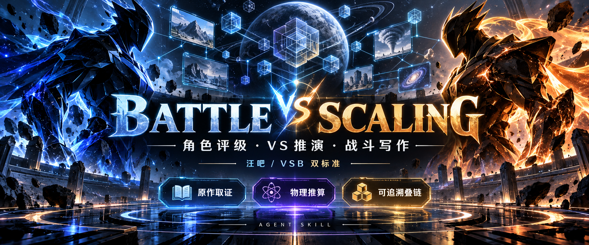

**简体中文** | [English](README.en.md)



<div align="center">

# Battle Scaling

### 让 Agent 会论战，也会把论战做成作品。

角色评级 · VS 推演 · 战斗故事 · 海报 · 一图流 · 卡点视频

   

**[下载完整工具包](https://github.com/LEE-path/battle-scaling/releases/download/v1.21.0/battle-scaling-v1.21.0.zip)** · [ 安装指南 ](docs/INSTALL.md) · [ 先看成品 ](#先看成品) · [Release](https://github.com/LEE-path/battle-scaling/releases/tag/v1.21.0)

</div>

从“这个版本到底有多强”，到有出处的综合评级、清楚的胜负手，再到能分享的图像与视频。默认汪吧，支持完整 VSB。定档、PK 和故事共用独立角色研究，媒体制作按需调用。

## 先看成品

动图先看效果，展开下方播放器观看完整有声 MP4 样片。

<table>
<tr><th>六宝石灭霸 vs 闪电侠</th><th>吕墨菲 vs 六宝石灭霸</th></tr>
<tr>
<td align="center"></td>
<td align="center"></td>
</tr>
<tr><td align="center">影视片段 · 音乐卡点 · 维度揭晓</td><td align="center">稀缺角色动画 · 动态插画 · 高光轮换</td></tr>
</table>

**剪辑与素材演示** · 片内给分用于展示剪辑，不作当前角色评级结论。 [ 示例说明与素材署名 ](docs/SHOWCASE.md)

<details>
<summary><b>完整有声样片 · 展开播放器</b></summary>

**Thanos vs The Flash / 六宝石灭霸 vs 闪电侠**

https://github.com/user-attachments/assets/aeb27429-cbfc-402f-851f-b4ba20bc6ce3

**Murphy Law vs Thanos / 吕墨菲 vs 六宝石灭霸**

https://github.com/user-attachments/assets/9ed4cdcf-7b0e-46dd-b62a-0cf67b1d39c3

</details>

### 同一场对战，也能做封面和一图流

<table>
<tr><th>影视角色海报</th><th>动画角色海报</th></tr>
<tr>
<td></td>
<td></td>
</tr>
</table>

<details>
<summary><b>也能做一图流胜负梗图 · 展开看示例</b></summary>

<p align="center"></p>

沿用既有结果：胜者左、败者右，贴图与配文独立排版；成图不反过来参与定级。

</details>


## 你想做到哪一步

<table>
<tr><td width="50%"><b>📚 原作搜证与拆书</b><br>查能力，也查能力的实际表现；追踪版本、状态、章节与原文上下文。</td><td width="50%"><b>📐 物理推算与高层叠链</b><br>材料、比例、受力与能量；数学结构、无限层级与叙事关系。</td></tr>
<tr><td width="50%"><b>⚖️ 综合定档与九维</b><br>汪吧／VSB，明确综合主档；九维、原始来源、叠法与限制一起给。</td><td width="50%"><b>⚔️ PK 与战斗写作</b><br>胜路、反制与反馈换招；保留人物性格、语言和清楚的战斗因果。</td></tr>
<tr><td width="50%"><b>🎬 从图片到可编辑视频</b><br>透明封面资产、一图流、九套音乐时序模板，交工程与 MP4。</td><td width="50%"><b>🔌 素材搜寻与生成扩展</b><br>搜索、提取与下载；接入图像／视频 API、MCP、CLI 或所选本地模型。</td></tr>
</table>

<details>
<summary><b>完整能力清单</b></summary>

| 能力 | 具体内容 |
|---|---|
| 原作搜证 | 逐项查能力及其实际表现，主动沿最强、同级和上下位比较查参照对象；关联官方补充作品、设定与主创原始访谈，核原文和上下文。 |
| 综合定档 | 同一版本、时期、状态与装备给一个综合主档，附九维、出处、叠法和限制；不让容易量化的局部下限代替综合判断。 |
| 物理推算 | 按需核比例尺、材料、结构、受力、毁坏机制、能量与误差；保存参数、公式、单位和可复算结果。 |
| 关系与高层结构 | 审查跨角色和跨状态的有效传递、无限层级、数学结构与叙事关系，使用所选口径的具名档位。 |
| 对战推演 | 宏观胜负、优势与翻转条件；按需写优势方获胜的一局完整战况，区分单局示例与总体胜率。 |
| 战斗写作 | 先独立评级，再按原作能力、人设、语言和世界观设计真实交锋、清楚的胜负手与结局；支持作者指定过程与胜者。 |
| 小说拆书 | 自包含的快照、分章任务、原文定位、逐能力表现、状态继承、顺序验收和末期档案；首次缺完整档案时优先拆书。 |
| 海报与一图流 | 原生透明 VS 模板与多款变体、人物选图方法、Pillow 拼贴和随包得意黑字体；接收既有结果，独立制作。 |
| 素材搜寻 | 多平台站点库与关键词、yt-dlp/gallery-dl、B站扫码高清下载、页面资源提取与裁切；按实际用途筛选素材。 |
| 稀缺角色与生成接入 | 原作外貌、能力和装备支撑统一形象；可绑定图像／视频 API、MCP、CLI 或本地模型，并提供图片动效兜底。 |
| 视频模板复刻 | 从参考视频的音轨、完整结构、入场、维度揭晓、动效到片尾，形成可换人物的可编辑模板。 |
| 属性卡点视频 | 九套独立音乐时序、可编辑 Remotion 工程、角色素材区间编排、双高光轮换和 MP4 导出；使用者自行提供有权使用的音轨及素材。 |

九维固定包含：**输出、体防、智力、战斗智商、经验、特殊技能、破坏、速度、体量**。速度等可继续分项；智力、经验使用适合该属性的能力等级，不硬套爆炸能量档。

</details>

## 两种标准，一个综合主档

- **汪吧 `wangba`（默认）**：使用随包的具名有限与高层规则，以及本 Skill 采用的特能双上限；规则及其原件指纹可追溯。
- **VSB `vsb`**：采用 VS Battles Wiki 的档位、属性、叠链、特能与对战规则；不是只替换档名，也不将汪吧特能封顶硬套过去。

每个配置只给一个综合评级。高光、通常和低谷表现用于审查代表性、出力及交手条件；**不再分别生成“最高／常态／扒下限”三套角色量级**。旧参数仅作兼容，不代表当前推荐用法。

可靠设定与比较关系可以支持上推；“表现优先”用于处理真正冲突。原作事实、合法推导、有据估档和未决条件分别标明。已知重要候选未处理完时，不以九维齐全或程序通过冒充完整评级。

## 三种对战输出

1. **宏观 VS**：配置、胜路、反制、优势程度／有据粗粒度胜率，以及对方可能获胜的条件。
2. **具体过程**：先确定总体优势方，再展开其获胜的一局，逐步处理行动、命中、防御、伤势和状态，最后说明总体胜负判断。
3. **故事版**：先执行完整独立评级，正文只写故事；没有给前因时按人物处境与能力设计入场和冲突，必须实际 PK，明确战果。对白、人物反应和关键因果充分展开，篇幅服从内容。

故事版默认取消强制新读图、视频下载和逐帧测量，复用合格档案、原作文字及可靠资料；独立评级、九维和关键能力交互不减。普通评级与论战的原有视觉取证流程保留。视频生成仅在明确请求时作为可选输出。

## 安装

需要 **Python 3.11+**，以及能搜索、阅读文件并执行工具的宿主 Agent。核心计算与拆书管线使用标准库；视觉、PDF、OCR、贴吧和视频工具按需配置，不内置模型权重。

```powershell
git clone https://github.com/LEE-path/battle-scaling.git
cd battle-scaling
python -X utf8 tools/setup.py install --profile full
```

推荐下载 Release 的 **完整包**或克隆整个仓库，再用上述安装命令。它创建隔离 Python 环境、安装轻量媒体／研究依赖与视频 npm 依赖，将完整 Skill 安装到 Codex 默认目录并绑定本次视频工程。需要预先安装 Python 3.11+；视频还需 Node.js 22.18+、npm、FFmpeg/ffprobe 和 Chrome/Edge。已有安装追加 `--upgrade`，被替换的静态文件先备份，运行数据保留。其他 Agent 用 `--skill-dir` 指定位置。详细步骤、能力对应关系及缺项检查见[完整安装指南](docs/INSTALL.md)。

也可手动将 `skills/battle-scaling` **整个目录**安装到 Agent 的技能目录；只复制这个文件夹不会复制视频项目或安装它的依赖。

也可用支持 GitHub 路径的 Skill 安装器：

```text
https://github.com/LEE-path/battle-scaling/tree/main/skills/battle-scaling
```

[可选依赖与许可](THIRD_PARTY_NOTICES.md#2-按需运行的工具--optional-runtime-tools)中分别列明 PDF、OCR、视频及贴吧工具。PyMuPDF 有 AGPL／商业许可要求，不能以本仓库 MIT 替代。默认量级计算不依赖完整量级册 PDF 或 OCR；正文搜索／原图核查需要使用者自行提供有权使用的匹配原件，见[公开分发说明](docs/public-distribution.md)。

## 任务示例

```text
评定某角色指定版本的综合量级，给九维、原始来源和完整叠法。
切换到 VSB 标准，评定同一角色；说明关键属性与特能限制。
A vs B：先完成双方独立评级，给宏观胜负、关键胜路与翻转条件。
A vs B，具体过程：先写总体优势方获胜的一局，再说明整体胜率。
A vs B，故事版：保留人设与能力，补合理前因，写完整交锋和明确结局。
为某小说角色建立结尾状态档案；没有完整档案时先用拆书管线。
分析这次单次表现，核材料、受力、状态和能力机制，再定档。
A vs B，故事版＋海报＋一图流：沿用指定配置，分别交付。
A vs B，严谨PK＋卡点视频：先定胜者和难度，再交可编辑工程与成片。
把我提供的参考视频复刻成可换人物模板，包含开场、维度揭晓、动效和片尾。
为冷门角色搜集适配素材；需要生成时，优先接入我已有的图像／视频后端。
```

Agent 从 [SKILL.md](skills/battle-scaling/SKILL.md)路由到所需资料。脚本不包含独立聊天模型，不会因生成索引、哈希或 JSON 就自动读懂原作。

完整包提供相同的方法、工具代码、模板与可复用资产。搜索／图像／视频生成能力由宿主或使用者配置的后端提供；账号、API Key、素材授权与音轨由使用者自行准备，不绑定某台电脑的会话或路径。

<details>
<summary><b>进阶命令：环境诊断、计算与小说拆书</b></summary>

在仓库根目录运行：

```powershell
python -X utf8 skills/battle-scaling/scripts/battle.py doctor
python -X utf8 tools/setup.py check
python -X utf8 tools/verify_package.py
python -X utf8 skills/battle-scaling/scripts/battle.py physics --input skills/battle-scaling/assets/cases/physics-earth-binding.json
```

拆书库既随 Skill 内置，也提供独立入口：

```powershell
python -X utf8 tools/combat-novel-refpack/refpack.py prepare --source book.txt --output runs/book --work "作品名" --edition "明确版本"
python -X utf8 tools/combat-novel-refpack/refpack.py tasks --bundle runs/book
# 宿主实际阅读并保存回执后，逐份顺序 accept。
python -X utf8 tools/combat-novel-refpack/refpack.py accept --bundle runs/book --input runs/actual-review.json
python -X utf8 tools/combat-novel-refpack/refpack.py build --bundle runs/book
python -X utf8 tools/combat-novel-refpack/refpack.py verify --bundle runs/book
```

未读原文保持部分覆盖，程序 `complete` 不替代宿主语义验收；候选 CASE 仍需正式定档。详见[独立拆书库](tools/combat-novel-refpack/README.md)与[完整拆书协议](skills/battle-scaling/references/novel-refpack-pipeline.md)。

</details>

## 把下一场对战做成视频

[`tools/battle-video-studio`](tools/battle-video-studio/README.md) 需要 Node.js 22.18+、npm、FFmpeg/ffprobe 和 Chrome/Edge。进入该目录运行 `npm ci`、`npm start`，访问 <http://127.0.0.1:3210>。从工作台导入双方素材，或提供任务 JSON。

```powershell
node scripts/select-template.mjs
node scripts/import-music.mjs --template V05 --file "你的音轨.wav"
npm run prepare-job -- 你的任务.json
npm run render -- --job 工程ID
```

先选模板，再提供与该模板剪切版及时点一致的音轨；相近 BPM 或足够时长不能证明匹配。随包保留时间参数、原创可复用 VS/品牌图及有许可字体，不附参考歌曲、人物图、视频或原研究成片。正式视频读取已有研究结论；素材语义由实际看片的宿主判断，编排器按已赋用途、精彩程度和原片区间安排，不按赢项数重新判胜。

本机维护同步工具及分发边界见[公开分发说明](docs/public-distribution.md)。同步只读取显式来源，排除运行库与用户素材，不执行提交、推送或 Release 操作。

完整安装器会写入私有视频路径，仓库内的包装器也可自动发现随包工程。手动安装时可设置 `BATTLE_VIDEO_STUDIO_ROOT` 或运行指针；`python tools/setup.py run <脚本名> ...` 可直接使用隔离环境运行素材和评级工具。

## 许可与鸣谢

**原创代码及原创文档：MIT。第三方资料保留各自许可。** VSB 改编资料和语义题集中 SCP 的短摘录/改述为 CC BY-SA 3.0；Cited Feats 普通数据为 CC BY 4.0、SCP 数据为 CC BY-SA 3.0。视频依赖 Remotion 使用其自己的 Remotion License，得意黑字体使用 SIL OFL 1.1，均不能冒称 MIT。完整依赖、来源、许可和适用范围见 [第三方说明](THIRD_PARTY_NOTICES.md)、[NOTICE](NOTICE.md)及[当前发布包审计](docs/CURRENT-RELEASE-AUDIT.md)。

特别感谢 [novel-refpack](https://github.com/scp3500/novel-refpack) 的拆书工作流参考。流程与研究还参考了 [AutoSkill](https://github.com/ECNU-ICALK/AutoSkill)、[OmniBattle](https://github.com/Zerhal/omnibattle-ai)、[vskill](https://github.com/GentleClash/vskill)、[Fictional Ranking](https://github.com/BenCantCode/fictional-ranking)、[Animal Battle Stats](https://github.com/RamiNoodle733/animal-battle-stats)、[QuantiPhy](https://github.com/Paulineli/QuantiPhy) 和 [MangaLMM](https://github.com/manga109/MangaLMM)。[Cited Feats](https://citedfeats.com/data/) 与 [ManGo](https://arxiv.org/abs/2608.29865) 使用其已核官网／论文入口；没有虚构实现仓库。

这些研究项目不是默认运行依赖，也不表示其模型已被本包安装或复现。安装归档不预置原作截图、整本小说、完整参考册 OCR、第三方模型权重或私有运行记录；另行链接的展示成图与样片按[示例说明](docs/SHOWCASE.md)保留来源及权利边界。写作参考使用[可复用写作经验](skills/battle-scaling/references/writing-experience.md)，不附教学故事或故事原文摘录。具体组件边界见上述许可与分发说明。
